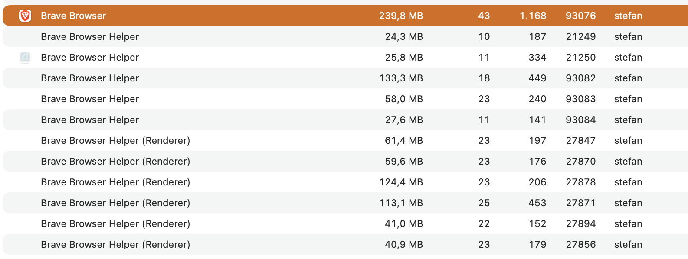
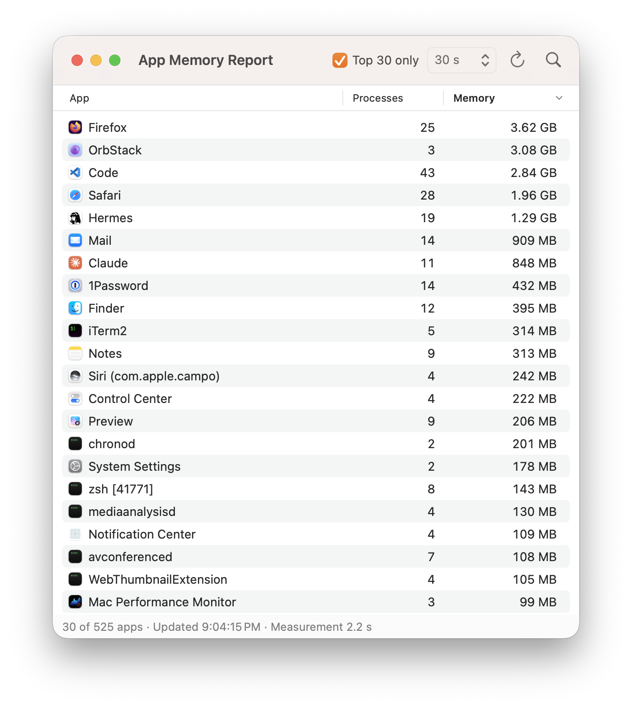

# 25 Tabs, Four Browsers, One Sofa

Every evening, once the real work is done (and the other work, the kind that only pretends not to be), I settle onto the sofa and work through a bookmark collection of news sites. It's a ritual, and rituals don't like surprises. So the bookmarks live in [raindrop.io](https://raindrop.io), which works the same on every machine and in every browser. Excitement is not what I'm looking for on the sofa.

The trouble with a tool that makes every browser equally convenient is that it removes the last excuse not to compare them. Twenty-four tabs a night is a benchmark that runs itself. So the engineer in me, who was supposed to be off duty, sat up and asked: **which browser uses the least memory?**

## Activity Monitor is not going to tell you

Activity Monitor answers that question roughly the way a phone book answers "who is my family?". Everyone is in there, just not grouped in any useful way:

- **Firefox** is spread across Firefox itself and a long list of *FirefoxCP Isolated Web Content*, *Utility Process*, *Web Content* and *WebExtensions* processes.
- **Brave** brings Brave plus a whole crowd of *Brave Browser Helper* and *Helper (Renderer)* processes.

  

- **Safari** lists your open URLs next to a collection of Safari and WebKit processes. That's charmingly honest, but it doesn't add up to a total.

You might be tempted to just add up the column. Don't: helper processes share memory pages, and a naive sum counts every shared page once for each process that maps it. You get a number, just not the right one.

## So "I" wrote a tool

The quotation marks are doing honest work here, as an AI did a good share of the typing (Fun fact: I asked the AI to polish this text, and apparently, it felt it deserved way more credit. That previous sentence was added by the AI itself.). [AppMemoryReport](https://github.com/krausest/AppMemoryReport) groups every helper, renderer and XPC service under the app that is responsible for it, using the same "responsible process" relation Activity Monitor uses internally. It then measures each app's processes *together* with Apple's `footprint` tool, so memory they share is counted only once. The metric is physical footprint, the same thing Activity Monitor calls "Memory", just summed correctly. The [README](../README.md) has the gory details.

## Round 1: no extensions

The setup: open all 24 bookmarks from the raindrop.io collection page (so 25 tabs, since the collection page stays open), with no extensions installed.

| Browser | Memory |
|---|---:|
| Chrome 155 | 6553.4 MB |
| Firefox | 5842.6 MB |
| Brave | 3767.6 MB |
| Safari 27 | 3658.1 MB |

Safari winning on its home turf is no shock. The surprise is the gap between **Chrome and Brave**: the same Chromium engine underneath, yet Chrome needs about 2.8 GB more for the same 25 tabs. Twins separated at birth, it seems, and raised on very different diets.

## Round 2: add an ad blocker

Then I installed an ad blocker: uBlock Origin in Firefox, and uBlock Origin Lite in Chrome and Safari.

| Browser | No extensions | With ad blocker | Change |
|---|---:|---:|---:|
| Chrome 155 (uBO Lite) | 6553.4 MB | 3482.3 MB | −46.9 % |
| Firefox (uBO) | 5842.6 MB | 4192.6 MB | −28.2 % |
| Safari 27 (uBO Lite) | 3658.1 MB | 1747.8 MB | −52.2 % |

Chrome sheds almost half its weight, and Safari more than half. It turns out a good chunk of a news site's memory appetite isn't the news at all.

That also offers a likely answer to the Chrome-vs-Brave riddle. Brave isn't in this table because it doesn't need an extension: it ships with its own blocker, Shields, switched on by default. Round 1 was therefore never quite a fair fight. Brave had been quietly blocking ads all along, and its 3767.6 MB sits right next to Chrome's 3482.3 MB once Chrome gets a blocker too.

**The moral:** if you want your browser to use less memory, choosing the right browser matters far less than installing an ad blocker.

## Round 3: add a password manager

For completeness, the same 25 tabs with 1Password enabled as well:

| Browser | Without 1Password | With 1Password | Difference |
|---|---:|---:|---:|
| Safari 27 (uBO Lite) | 1747.8 MB | 2271.2 MB | +523.4 MB |
| Firefox (uBO) | 4192.6 MB | 4917.7 MB | +725.1 MB |
| Brave (Shields) | 3767.6 MB | 3806.7 MB | +39.1 MB |

Safari and Firefox pay half a gigabyte or more for the convenience. Brave barely notices: it adds just 39 MB. I don't have an explanation for that yet. If you do, I'm all ears.

## Try it yourself

The code is on GitHub: <https://github.com/krausest/AppMemoryReport>

There's no prebuilt release yet, because I don't have an Apple Developer account to notarize the app. If you'd like a notarized build, say so in [this issue](https://github.com/krausest/AppMemoryReport/issues/1). Enough votes and I'll pay Apple's entry fee. In the meantime, the sofa is calling, and 25 tabs are waiting.
